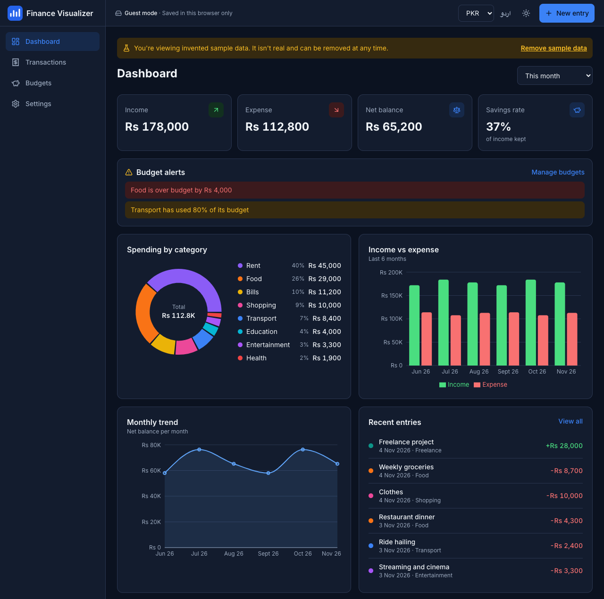
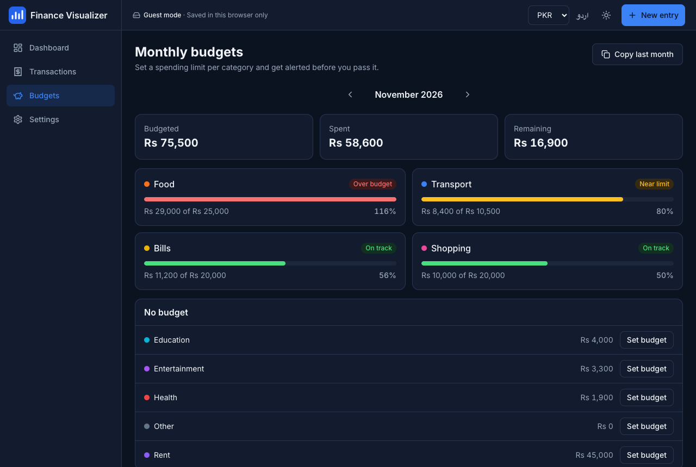

# Personal Finance Visualizer

Track income and expenses, set monthly budgets, and see where your money goes. It opens straight into the app with no signup, and works in English and Urdu, in PKR or USD, on phone and desktop.

**[Live demo](https://personal-finance-visualizer-ochre-psi.vercel.app)**: choose "Explore with sample data" to see it populated. Sample data is invented, clearly labelled, and removable in one click.



## Features

- **Transactions:** add, edit and delete, with validation, search, and type, category and date filters. Filters live in the URL, so a view survives a refresh.
- **Dashboard:** spending by category, income vs expense, and monthly net trend, with totals for any date range.
- **Budgets:** per-category monthly limits, near-limit and over-limit alerts, and one-click copy from last month.
- **CSV import:** preview before saving, per-row error messages, duplicate detection, and common bank formats.
- **CSV export:** of any filtered view, safe to open in Excel.
- **Guest mode or account:** data stays in the browser by default. An optional account syncs it and can take over existing guest entries.
- **Urdu with full right-to-left layout**, dark mode, and a phone layout with bottom navigation.



## Tech stack

React 18, TypeScript (strict), Vite, Tailwind CSS 4, React Router, Recharts, PapaParse, Supabase (Auth and Postgres), Vitest, ESLint, GitHub Actions.

## Architecture

```
src/
  lib/          Pure logic with no React: calculations, budgets, CSV, dates, money
  lib/repository.ts   FinanceRepository interface, with Local and Supabase implementations
  context/      Auth, preferences, and the finance state that talks to a repository
  components/   Layout, charts, entry and import dialogs, shared UI
  pages/        Dashboard, Transactions, Budgets, Settings, Auth
  i18n/         English and Urdu strings
supabase/schema.sql   Tables, constraints and row-level security
```

Pages never know where data is stored. `FinanceContext` picks `LocalRepository` for guests or `SupabaseRepository` for signed-in users, and everything above that line is the same code.

## Decisions worth explaining

| Decision | Why |
|---|---|
| Sum money in minor units | Floating-point addition gives `0.1 + 0.2 = 0.30000000000000004`. Totals are added as whole paisa or cents. |
| Dates stored as `YYYY-MM-DD` text in the app | A `Date` converted through UTC can land on the previous day in Pakistan (UTC+5). A calendar date has no timezone to shift. |
| Optimistic updates, reload on failure | The screen responds instantly. If a save fails, the app shows an error and reloads the source of truth instead of guessing how to undo. |
| Row-level security in Postgres | The anon key ships to every browser, so the database has to enforce isolation. Filtering by `user_id` in the client isn't a security boundary. |
| Currency changes the symbol only | The app holds one currency, so there's no exchange rate to go stale. Converting would silently change what users recorded. |
| Day-first dates on CSV import | `05/01/2026` means 5 January on Pakistani bank statements. This is documented in the import dialog. |
| Escape formulas on CSV export | A description like `=HYPERLINK(...)` could run when the file is opened in a spreadsheet. Risky cells get a leading apostrophe, which the importer removes, so files round-trip. |
| Corrupted storage isn't wiped | The app shows an error and the user chooses whether to reset, so a bug can't silently destroy their data. |
| Native `<dialog>` instead of a UI library | It provides focus trapping and Esc handling with no dependency. The Figma-generated starter's unused UI packages were removed. |
| Urdu strings typed against English | A missing translation fails the type check, and a test confirms placeholders match. |

## Known limitations

- One currency per user, with no conversion.
- Guest data lives in one browser, and clearing site data erases it. The app says so and offers CSV export.
- Budgets are set month by month rather than recurring. "Copy last month" covers the common case.
- Editing a built-in category changes its color only, because built-in names are translated.

## Run it locally

Requires Node 20 or newer.

```bash
npm install
npm run dev
```

The app runs fully in guest mode with no configuration.

### Optional: accounts and sync

1. Create a [Supabase](https://supabase.com) project.
2. Run `supabase/schema.sql` in its SQL editor.
3. Run `cp .env.example .env` and fill in the project URL and anon key. Never use the `service_role` key here, because `VITE_` values ship to the browser.
4. In Supabase Auth, add your site URL and `<site>/new-password` as redirect URLs.

To offer Google sign-in, enable that provider in Supabase and set `VITE_ENABLE_GOOGLE_AUTH=true`.

## Quality checks

```bash
npm run lint
npm run typecheck
npm test
npm run build
npm run check   # all of the above
```

Unit tests cover calculations, budgets, CSV parsing and export, date handling, storage and translations. CI runs every check on each push and pull request.
